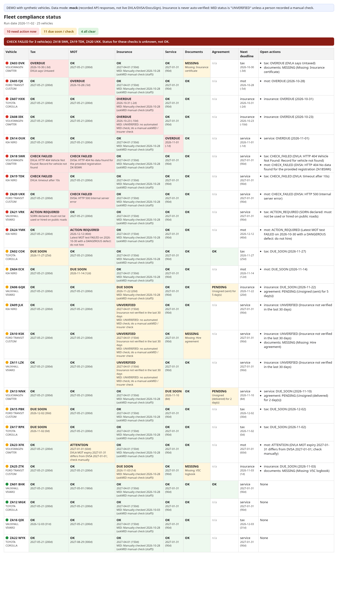

# Fleet compliance assistant (demo)

A daily check of a UK rental fleet: road tax and MOT from the official DVLA and DVSA APIs, insurance, servicing, missing documents and unsigned DocuSign hire agreements. It sends tiered reminders and urgent alerts by email and WhatsApp, escalates anything nobody acknowledges, logs every check and message, and shows a one-page status dashboard.

**This is a demo.** All 25 vehicles are fictional ("ZA" plates, which are not issued in the current GB format). DVLA, DVSA and DocuSign answers come from recorded responses written in each API's documented format, because no API keys exist yet. Nothing is sent: messages go to an outbox file until someone deliberately turns sending on in n8n.



## Quick start (about 2 minutes, needs Node.js 18+)

```bash
npm run demo -- --today 2026-11-02   # one daily run on recorded data
open out/dashboard.html                # or double-click it
npm test                               # unit tests, messy-input stress test (tests/STRESS_RESULTS.md), plan acceptance tests (tests/RESULTS.md)
```

`out/` then holds `dashboard.html`, `status.json`, `audit_log.csv` (append-only), `outbox.jsonl` (messages that would be sent) and `state.json` (which reminders already went out, so nothing is sent twice).

## How it works

```
n8n (daily 07:00 UK) -> node src/run.js --json -> one item per alert -> SEND_ENABLED=yes? -> Twilio WhatsApp / SMTP email -> delivery result into the audit log
                                                                     \-> no: logged as DRY_RUN, nothing sent
```

| Check | Source | Rule |
|---|---|---|
| Road tax | DVLA Vehicle Enquiry Service | Untaxed = OVERDUE, SORN = ACTION REQUIRED (must not be hired), due within 30 days = DUE SOON |
| MOT | DVSA MOT History (DVLA date as cross-check) | Expiry from the latest PASS. Latest test FAILED with a dangerous defect = ACTION REQUIRED. DVLA and DVSA dates disagree = ATTENTION |
| Insurance | Register (policy dates + who checked it) | **Never auto-verified.** Shows UNVERIFIED unless a person recorded a manual askMID or insurer check in the last 30 days. Expired = OVERDUE |
| Service | Register | Date rule as above |
| Documents | `documents.csv` | Any required document not marked "yes" = MISSING |
| Hire agreement | DocuSign envelope status | Not `completed` = PENDING; `declined`/`voided` = ACTION REQUIRED |

Any lookup that errors (unknown registration, timeout, bad key, server error) or any unreadable date shows **CHECK FAILED**, which is red, raises an alert in the same run and is never treated as OK.

Reminders follow a 30/14/7/1-day ladder, one message per step, never repeated. Red items send one urgent alert. If nobody acknowledges it in `data/acknowledgements.csv` within 2 days, it goes to the escalation contact. The item stays red until the underlying check is clear. All the numbers live in `data/config.json`.

## Switching to live data

1. Fill in `.env` from `.env.example` (see "Accounts" below).
2. `FLEET_MODE=live npm run demo`. If any key is missing it stops and names it rather than falling back to recorded data.
3. Only when the output looks right, set `SEND_ENABLED=yes` in n8n.

## n8n

`n8n/fleet-compliance.workflow.json` is the importable workflow (rebuild it with `npm run build:n8n`). n8n handles the schedule, the sending and the credentials. The rules run as `src/run.js` through the Execute Command node, so n8n runs exactly the code the tests cover. The workflow holds no secrets: Twilio and SMTP credentials are referenced by name and created in n8n. See `docs/HANDOVER.md` for setup and `tests/n8n_import_result.txt` for what was checked on a local n8n.

## Integration limits (be upfront with the client)

- **Insurance / MID:** there is no free bulk API for the Motor Insurance Database. askMID (https://ownvehicle.askmid.com/) checks one vehicle at a time and is for your own vehicles. Automated fleet checks need an authorised commercial route through the MIB or the insurer's fleet portal. So this system records who checked and when, and shows **UNVERIFIED** instead of guessing. It does not scrape askMID.
- **DVLA VES API:** as of 28 Oct 2026 the DVLA registration page says new registrations are closed during system upgrades. Until it reopens, tax status stays on recorded or manual data.
- **DVSA MOT History API:** free. Registration takes up to 5 working days.
- **Fleetworks:** not connected. It depends on whether the client's plan has an API or a scheduled export. The fallback is a scheduled export into `register.csv`.
- **DocuSign:** the demo reads envelope status. Going live on the client's account needs a DocuSign app and its go-live review.
- **WhatsApp:** business-initiated messages need an approved template outside the 24-hour window. The Twilio sandbox only reaches numbers that have joined it.

## Files

| Path | What it is |
|---|---|
| `src/engine.js` | Rules (pure functions, no network) |
| `src/adapters.js` | Mock/live switch for DVLA, DVSA, DocuSign |
| `src/run.js`, `src/dashboard.js`, `src/io.js`, `src/log_delivery.js` | Daily run, dashboard, CSV, delivery logging |
| `data/` | Synthetic register, documents, acknowledgements, config, hand-written answer key |
| `fixtures/` | Recorded API responses (documented formats), including error cases |
| `n8n/` | Importable workflow |
| `tests/` | Unit tests, acceptance tests (`evaluate.js`), `RESULTS.md` |
| `docs/` | Input spec, handover, change management, running costs, realism review, code reviews, reviewer questions, screenshot |
| `TIME_LOG.md` | Estimate vs actual |

Licence: code is PolyForm Noncommercial 1.0.0; docs and data are CC BY-NC 4.0. See `LICENSE`.
