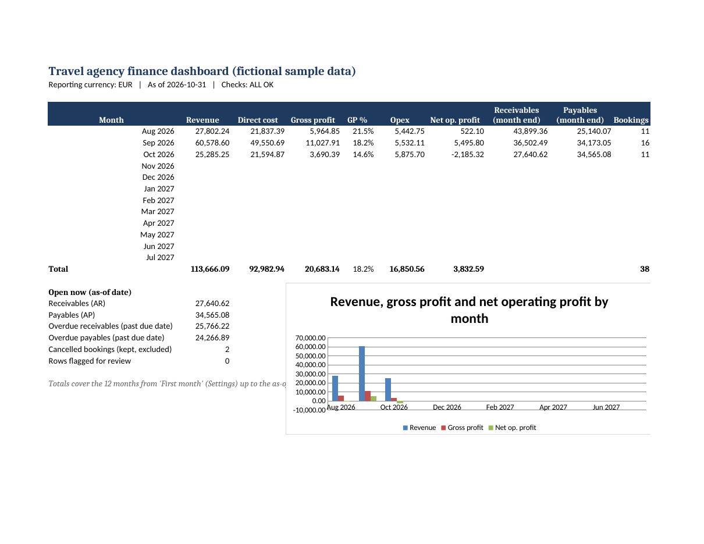

# Travel agency finance workbook (portfolio demo)

An Excel finance system for a fictional B2B agency in the Balkans. It covers bookings (FIT and group), profit per booking, invoices, supplier bills, full and partial payments, expenses, EUR/BAM/USD amounts, a monthly dashboard and reports. It uses Excel Tables with SUMIFS and XLOOKUP and has no macros. All names and figures are fictional.

**Sample results** (EUR, Aug–Oct 2026, as of 31 Oct 2026):
- Revenue 113,666.09
- Gross profit 20,683.14 (18.2%)
- Opex 16,850.56
- Net operating profit 3,832.59
- Receivables 27,640.62
- Payables 34,565.08
- 38 active bookings plus 2 cancelled
- Checks: ALL OK

## Files
| File | What |
|---|---|
| TravelAgency_Finance_Workbook.xlsx | Workbook with sample data |
| TravelAgency_Finance_Workbook_BLANK.xlsx | Empty go-live copy |
| HANDOVER_GUIDE.md / .pdf | Daily use guide |
| TEST_REPORT.md, tests/results.json | Results of tests T01–T12 |
| tests/recheck.py | Independent Python recomputation from the typed inputs only |
| tests/run_tests.py | Test runner (needs LibreOffice for recalculation) |
| src/ | Builder (openpyxl), sample data generator, instructions |

To rebuild and test, run `python3 src/build_workbook.py`, then `python3 tests/run_tests.py`.

## Requirements: honest status
| Req | Status | Evidence |
|---|---|---|
| R01 Booking register | PASS | T01: 40/40 bookings (24 FIT, 16 group, 2 cancelled) |
| R02 Profit per booking | PASS | T01: 40/40 match to 0.01 |
| R03 Expenses log | PASS (structure) | Expenses table feeds dashboard Opex; recheck agrees |
| R04 Invoices and balances | PASS | T02 and the 706/706 recheck |
| R05 Supplier bills and payables | PASS | T02 and the 706/706 recheck |
| R06 Full and partial payments | PASS | T02: 10/10 scripted cases (partials, overpayment flag, refund, FX) |
| R07 EUR/BAM/USD with base switch | PASS | T03: 3/3 bases at 706/706 figures each. Revenue is 113,666.09 EUR, 222,311.55 BAM (EUR × 1.95583) |
| R08 Dashboard | PASS | T04 (19/19 checks) and T05 (101/101 dashboard cells) |
| R09 Reports by month, destination, customer and salesperson | PASS | T05: 4/4 ties, 72/72 report rows |
| R10 Validation, protection, instructions | PARTIAL | T07: 8/8 bad inputs flagged. T08 structure is 80/80 but needs a manual check in Excel. Data sheets are not sheet-protected, because Excel tables can't grow on protected sheets. Their formula cells are locked and grey. |
| R11 Editable, sample data | PASS | No macros, no passwords, sample data included |
| R12 Tested | PASS | T01–T03 |
| R13 Handover guide | PARTIAL | The guide is written. T12, where someone else uses it unaided, hasn't been run yet. |
| R14 BAM peg and USD rate by date | PASS | T03 and the Rates table (weekly) |
| R15 Control checks | PASS | T04: 19/19 checks. An overpayment is flagged (T02 case T3). |
| R16 Aging buckets | PASS | T06: 12/12 seeded cases, 125/125 buckets |
| R17 Tables extend automatically | PASS | T09: 5 bookings added gave revenue +5,010.00 and AR +3,010.00. The recheck was 741/741 and 37/37 calculated columns were present. |
| R18 Cancelled excluded, unique IDs | PASS | T01 and T07 (a duplicate ID is flagged) |
| R19 Performance at 2,000 bookings / 5,000 payments | FAIL (threshold) | T10: a full recalculation took 11.9 s in headless LibreOffice on a small server, against a target of 3 s or less. The recheck matched 25,422/25,422 figures. Not yet timed in desktop Excel, which is usually faster. |
| R20 Blank copy | PASS | T11: 0 error cells and Checks ALL OK |

## Caveats
- All recalculation was done in LibreOffice. Open the file in desktop Excel once to confirm XLOOKUP, SWITCH, TEXTJOIN, protection and the chart.
- The sample's overdue share is high (25,766 of 27,640 receivables are past due), because the sample generator leaves a share of past-due items unpaid to exercise the aging report.
- FX rates are illustrative. There is no live feed.

## Licence
Code: PolyForm Noncommercial 1.0.0. Docs and workbook: CC BY-NC 4.0. See LICENSE. Copyright Yannick Silva.
